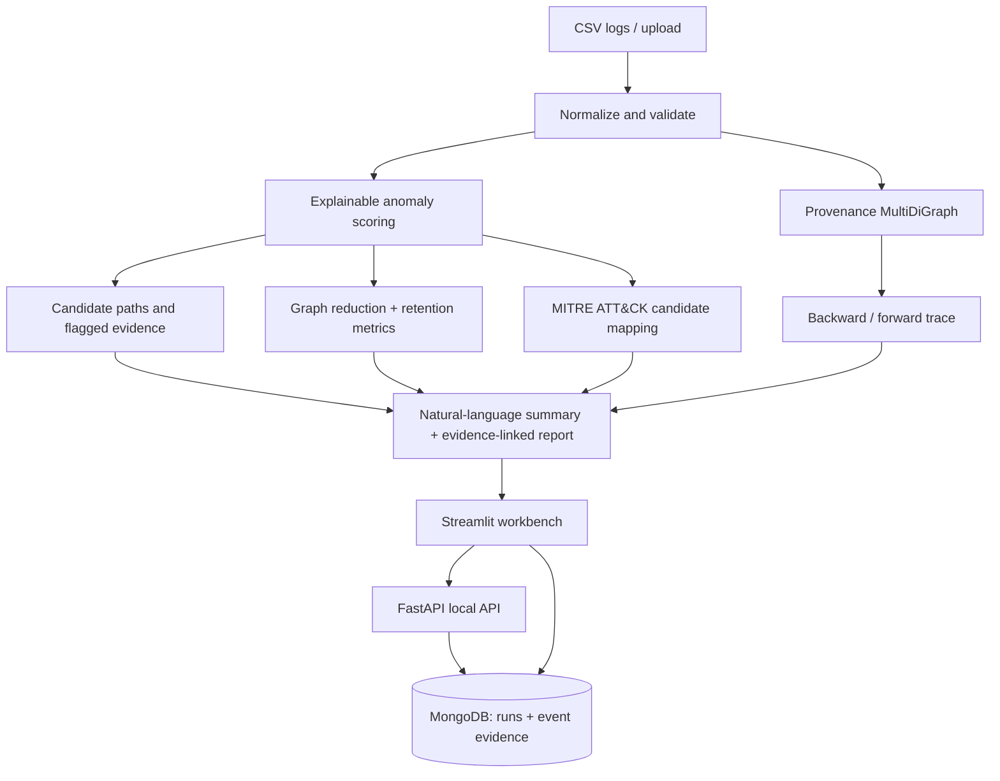

# RansomTrace AI — PS-30 Incident Reconstruction Workbench

RansomTrace AI is a local-first cybersecurity investigation prototype for turning security log records into an evidence-linked investigation: normalization, provenance graph construction, explainable anomaly scoring, backward/forward tracing, graph reduction, candidate MITRE ATT&CK mapping, timeline visualization, natural-language summary, and searchable investigation history.

> **Scope and safety:** This is an educational lab/hackathon prototype, not a production SIEM/EDR or a substitute for a forensic investigator. Included records are synthetic. A graph edge records a relationship asserted by a log; it is not automatically proof of causation. Scores and ATT&CK mappings are hypotheses and must be checked against original evidence.

## Features

- **Executive summary page:** deterministic natural-language summary, triage priority, key events, affected hosts, recommended analyst actions, and evidence IDs.
- **Evidence-linked incident report:** downloadable Markdown report with event IDs, timestamps, entity relationships, scoring rationale, ATT&CK references, metrics, and caveats. Search an event ID in the evidence page to inspect the original normalized fields.
- **Log search:** search current logs by event ID, entity, host, event type, details, or reason; inspect an individual event and export matching results.
- **Investigation history:** stores run metadata, metrics, summary, and searchable event records in local MongoDB. Search prior event evidence by text or event ID and export matches.
- **Local FastAPI backend:** read-only endpoints for health, saved runs, run details, and evidence search.
- **Graph, timeline, trace, ATT&CK and evaluation pages.**
- **Six bundled synthetic scenarios:** the original three plus ransomware, web server intrusion, and lateral movement examples.

## Architecture



## Project layout

```text
RansomTrace_AI_PS30_Complete_Solution/
├── app.py                       # Streamlit dashboard/workbench
├── backend/api.py               # Local FastAPI history/search API
├── docker-compose.yml           # Local MongoDB only
├── data/                        # Six synthetic scenarios + ground truth
├── src/normalize.py             # Input normalization
├── src/detect.py                # Transparent scoring heuristics
├── src/graph.py                 # Provenance graph + reduction
├── src/trace.py                 # Candidate paths and entity tracing
├── src/attack_mapping.py        # Event-linked ATT&CK hypotheses
├── src/summarize.py              # Natural-language summary/report evidence links
├── src/storage.py                # MongoDB persistence and event search
├── src/evaluate.py               # Evaluation metrics
└── tests/                        # Automated tests
```

## 1. Local installation (Ubuntu/Linux)

Install Python 3.10+ and Docker with Docker Compose. MongoDB can alternatively be installed as a native local service.

```bash
cd RansomTrace_AI_PS30_Complete_Solution
python3 -m venv .venv
source .venv/bin/activate
python -m pip install --upgrade pip
pip install -r requirements.txt
cp .env.example .env
```

Default local configuration in `.env`:

```env
MONGODB_URI=mongodb://localhost:27017
MONGODB_DATABASE=ransomtrace_ai
API_HOST=127.0.0.1
API_PORT=8000
```

### Start MongoDB locally with Docker

From the project root:

```bash
docker compose up -d mongo
docker compose ps
```

The MongoDB port is bound to `127.0.0.1` only. Data persists in the Docker volume `ransomtrace_mongo_data`. To stop MongoDB without deleting data:

```bash
docker compose stop mongo
```

Do not use `docker compose down -v` unless you intentionally want to delete the database volume and saved history.

### Start the dashboard

In terminal 1:

```bash
source .venv/bin/activate
streamlit run app.py
```

Open `http://localhost:8501`.

### Start the local backend API (optional but included)

In terminal 2:

```bash
source .venv/bin/activate
uvicorn backend.api:app --reload --host 127.0.0.1 --port 8000
```

API docs: `http://127.0.0.1:8000/docs`

Endpoints:

- `GET /health` — backend and MongoDB health
- `GET /api/runs?limit=50` — saved investigation history
- `GET /api/runs/{run_id}` — one saved result
- `GET /api/evidence/search?q=powershell&limit=100` — search event evidence

The dashboard uses the shared local MongoDB storage module directly. The API exposes the same saved history to scripts and other local tools. The API currently provides read-only history/search routes; it does not accept arbitrary remote log uploads.

## 2. Using the application

1. Start MongoDB, then start Streamlit.
2. Choose one of the six built-in scenarios or upload an authorized CSV.
3. Set the anomaly-score threshold in the sidebar.
4. Read **Executive summary** first for the plain-language findings, priority events, caveats, and recommended analyst actions.
5. Use **Log search & evidence** to find an event ID or search for a host/process/keyword.
6. Compare original and reduced graphs; check event retention before trusting reduction.
7. Use backward tracing to inspect possible preceding activity and forward tracing to inspect possible impact.
8. Review candidate ATT&CK mappings and open their official reference links.
9. Download the evidence-linked incident report and CSV/JSON exports.
10. Open **History & saved results** to inspect prior runs and search their stored event evidence.

Each distinct dataset-content + threshold combination is saved once in MongoDB. Re-opening the same combination does not create a duplicate run. If MongoDB is unavailable, the analysis dashboard remains usable for the current session, but persistent history is unavailable until the database is started.

## 3. Dataset schema

The loader accepts common aliases and normalizes records to these fields:

`event_id, timestamp, source_entity, target_entity, event_type, host, process_id, parent_process_id, details, label`

`label` is used for evaluation only. The detector must not use it to assign scores. Ground-truth JSON files list the expected attack event IDs for each synthetic scenario.

Bundled scenarios:

- `company_week_logs.csv`
- `college_website_week_logs.csv`
- `enterprise_endpoint_week_logs.csv`
- `ransomware_incident_extra.csv`
- `web_server_intrusion_extra.csv`
- `lateral_movement_extra.csv`

All six are synthetic. They are not DARPA Transparent Computing data and were not captured from a real lab VM. For external validation, obtain authorized DARPA TC/LANL data and write an adapter that maps the source schema into the fields above. Document any fields that are unavailable rather than inventing them.

## 4. CLI pipeline and evaluation

```bash
python run_pipeline.py --input data/company_week_logs.csv --output outputs/company
python evaluate_scenarios.py
pytest -q
```

To record time-to-insight, measure a predefined task with real participants and supply the observed duration; do not invent it. The application deliberately leaves it unset unless measured.

## 5. How the natural-language summary works

The included summary engine is deterministic and local. It converts the top-ranked flagged events, event timestamps, hosts, scores, rule explanations, ATT&CK candidates, and evaluation metrics into readable text. It links each finding to the original `event_id` and provides an evidence appendix. It does not call an external LLM or send security logs to a third party. If an LLM integration is added later, require explicit configuration, redact sensitive data, preserve event citations, and distinguish quoted evidence from generated interpretation.

## 6. Metrics and interpretation

Report at minimum:

- Attack-event recall = true-positive attack events / all ground-truth attack events.
- Precision = true-positive detections / all events flagged.
- F1 score.
- Node and edge reduction percentages.
- Attack-event retention after graph reduction.
- Runtime and analyst time-to-insight measured in a controlled task.

Perfect results on synthetic data do not demonstrate real-world detection performance. Avoid tuning against the evaluation scenario; use separate development and evaluation data and report false positives and missed attack events.

## 7. Troubleshooting

**MongoDB status says unavailable**

```bash
docker compose up -d mongo
docker compose logs mongo
```

Check `.env` uses `mongodb://localhost:27017`. Refresh the Streamlit page after MongoDB is healthy.

**`pymongo is not installed`**

```bash
source .venv/bin/activate
pip install -r requirements.txt
```

**Port 27017 or 8000 is already in use**

Stop the existing local service or change the host port and update `MONGODB_URI`/API launch command accordingly.

**No saved runs in history**

History is only persisted when MongoDB is connected. Start the database and analyze a dataset again.

## Limitations

- Rule-based scoring can generate false positives and false negatives.
- Candidate paths are chronological/entity-linked groupings, not formal causal inference.
- Graph reduction is heuristic and can drop attack evidence; review the retention metric.
- ATT&CK mappings are candidates and require contextual validation.
- The synthetic datasets are small and do not establish real-world accuracy.
- Authentication and role-based access control are not implemented; keep the API and MongoDB bound to localhost unless you add appropriate security controls.
